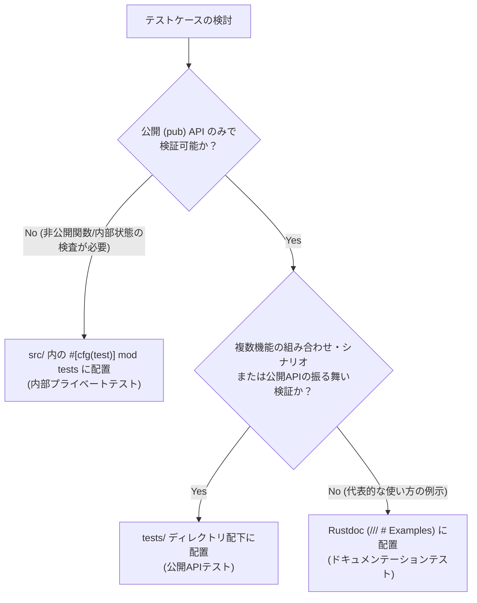

# Rust テスト設計・分離規約 (Rust Testing Architecture & Separation Rules)

> [!IMPORTANT]
> 本規約は、`Re-CraftLaunch` プロジェクトにおけるテストコードの配置、責務分離、および公開API/内部プライベートテストの使い分けを規定する恒久ルールです。
> ソースコードの肥大化を防ぎ、公開APIのエルゴノミクス（使いやすさ）と内部アルゴリズムの健全性を両立させることを目的とします。

---

## 1. 基本方針（責務の明確な分離）

テストコードはその検証対象とテスト観点（外部視点 vs 内部視点）に応じて、配置場所を厳格に分離します。

```
                    ┌─────────────────────────────────────────┐
                    │            Rust テスト体系              │
                    └────────────────────┬────────────────────┘
                                         │
                 ┌───────────────────────┴───────────────────────┐
                 ▼                                               ▼
     【公開APIテスト (結合・仕様)】                  【内部プライベートテスト (単体)】
     ・配置: tests/*.rs (tests/ ディレクトリ)        ・配置: src/ 内 (#[cfg(test)] mod tests)
     ・視点: 外部利用者 (ブラックボックス)           ・視点: モジュール内部 (ホワイトボックス)
     ・対象: 公開API (pub)                           ・対象: 非公開関数・内部状態・低レイヤ詳細
     ・インポート: use re_craftlaunch::...;          ・インポート: use super::*;
```

---

## 2. テストの分類と配置基準

### 2.1 公開APIテスト（Integration / Public API Tests）
- **配置ディレクトリ**: プロジェクト直下 `tests/`（例: `tests/calc_integration.rs`, `tests/completion_test.rs`）
- **アクセス権限**: 外部利用者と全く同じ権限（`pub` なシンボルのみアクセス可能）。
- **目的**:
  - アプリケーションやライブラリモジュールが提供する公開APIの仕様・振る舞い・エルゴノミクスを検証する。
  - ショートカットインデックス検索、電卓計算評価などのシナリオテスト、ユースケーステスト。
  - 外部利用者にとって破壊的変更（Breaking Change）がないかの検知。
- **ファイル命名・構成**:
  - 機能やコンポーネント単位でファイル分割（例: `tests/calculator.rs`, `tests/indexer.rs`）。
  - テスト間で共有するフィクスチャやユーティリティは `tests/common/mod.rs` に配置する（独立したテストターゲットとしてビルドされるのを防ぐため）。

### 2.2 内部プライベートテスト（Unit / Internal Tests）
- **配置ディレクトリ**: ソースコードと同じファイル内（`src/*.rs` 末尾の `#[cfg(test)] mod tests`）
- **アクセス権限**: モジュール内部の非公開関数、構造体のプライベートフィールド、ヘルパー関数。
- **目的**:
  - 非公開アルゴリズムやエッジケースのピンポイント検証。
  - 外部に公開する必要のない内部変換ロジックや状態遷移の検証。
- **ファイル肥大化防止の原則**:
  - `src/` 配下のファイルがテストコードによって過度に長くなるのを防ぐため、公開APIのみで検証可能なテストは原則として `tests/` に移譲すること。

### 2.3 ドキュメンテーションテスト（Documentation Tests）
- **配置場所**: 公開関数・型のドキュメンテーションコメント（`/// # Examples`）
- **目的**:
  - ドキュメント内の使用例が常に動作することの担保。
  - 公開APIシグネチャの検証（`cargo test --doc` で実行）。
- **詳細は [.agents/rules/rustdoc.md](file:///.agents/rules/rustdoc.md) を参照**。

---

## 3. 使い分けの判断フロー

テストコードを追加・修正する際は、以下の判断フローに従って配置場所を決定してください。



---

## 4. ディレクトリ構成パターン

```text
Re-CraftLaunch/
├── Cargo.toml
├── src/
│   ├── main.rs
│   ├── lib.rs
│   ├── calc.rs                     # 内部プライベートテストのみを内包
│   │   └── #[cfg(test)]
│   │       mod tests {
│   │           use super::*;
│   │           // 非公開パース処理のエッジケーステスト
│   │       }
│   └── indexer.rs
└── tests/                          # 公開APIテスト（tests/ ディレクトリに集約）
    ├── common/
    │   └── mod.rs                  # テスト共通フィクスチャ・ヘルパー
    ├── calc_integration.rs        # 四則演算の公開APIテスト
    └── indexer_integration.rs     # ショートカット検索のシナリオテスト
```

---

## 5. テスト実行コマンドと検証

| コマンド                         | 検証対象                                                |
| :------------------------------- | :------------------------------------------------------ |
| `cargo test --all-targets`       | 単体テスト、公開API統合テスト、バイナリ等すべてのテスト |
| `cargo test --test <ファイル名>` | 指定した `tests/<ファイル名>.rs` の統合テストのみ実行   |
| `cargo test --lib`               | `src/` 配下のライブラリ単体テストのみ実行               |
| `cargo test --doc`               | Rustdoc 内のコード例テストのみ実行                      |
